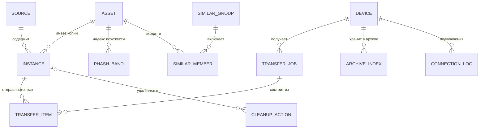

# Модель данных

У каждого устройства — **своя локальная база SQLite** с одной и той же схемой (Room 3, [ADR 0010](adr/0010-room3.md)).
Серверной базы данных в v1.0 нет.

Секреты (токены облаков, приватные ключи устройства) в базе **не хранятся** — только в защищённом
хранилище ОС (Keychain / Android Keystore / системный keyring), см. [безопасность](security-privacy.md).

## Главная идея: «фотография» и «копии»

Одна и та же фотография может лежать в пяти местах. Поэтому разделяем:

- **asset** — логическая фотография (или видео): «снимок заката 12 июля 2025 в 21:14»;
- **instance** — физическая копия в конкретном источнике: «файл `IMG_1234.HEIC` в Яндекс Диске, 3,1 МБ».

Лента показывает **assets**. Карточка «Где лежит» показывает все **instances** одного asset.
Дубли между облаками — это просто asset с несколькими instances.



## Схема (черновик)

```sql
-- Подключённые источники
CREATE TABLE source (
  id              INTEGER PRIMARY KEY,
  kind            TEXT    NOT NULL,  -- DEVICE_GALLERY, YANDEX_DISK, DROPBOX, ONEDRIVE, WEBDAV,
                                     -- GOOGLE_PHOTOS_PICKER, GOOGLE_TAKEOUT, LOCAL_FOLDER, PIXROOST_ARCHIVE
  title           TEXT    NOT NULL,  -- «Яндекс Диск», «Архив на ПК-Дом»
  account_label   TEXT,              -- логин, который видит пользователь
  config_json     TEXT    NOT NULL DEFAULT '{}',
  sync_cursor     TEXT,              -- курсор инкрементальной синхронизации
  quota_total     INTEGER,
  quota_used      INTEGER,
  is_trusted      INTEGER NOT NULL DEFAULT 0,  -- «надёжное хранилище» для правила безопасности
  status          TEXT    NOT NULL,  -- OK, SYNCING, AUTH_REQUIRED, ERROR, DISABLED
  last_sync_at    INTEGER
);

-- Логическая фотография / видео
CREATE TABLE asset (
  id                INTEGER PRIMARY KEY,
  media_type        TEXT    NOT NULL,  -- PHOTO, VIDEO, LIVE_PHOTO
  taken_at          INTEGER,           -- UTC, мс; из EXIF DateTimeOriginal или метаданных источника
  tz_offset_min     INTEGER,
  width             INTEGER,
  height            INTEGER,
  duration_ms       INTEGER,
  phash             INTEGER,           -- 64-битный perceptual hash превью
  best_instance_id  INTEGER            -- копия лучшего качества (только для просмотра, не для уборки)
);
CREATE INDEX asset_taken_at ON asset(taken_at DESC);

-- Физическая копия в источнике
CREATE TABLE instance (
  id             INTEGER PRIMARY KEY,
  asset_id       INTEGER NOT NULL REFERENCES asset(id),
  source_id      INTEGER NOT NULL REFERENCES source(id) ON DELETE CASCADE,
  remote_key     TEXT    NOT NULL,     -- id или путь внутри источника
  file_name      TEXT,
  mime_type      TEXT,
  size_bytes     INTEGER,
  md5            BLOB,                 -- если известен (от провайдера или посчитан)
  sha256         BLOB,                 -- если известен
  provider_hash  TEXT,                 -- хэш в формате провайдера: Dropbox content_hash, quickXorHash
  quality        TEXT    NOT NULL,     -- ORIGINAL, REDUCED, UNKNOWN
  modified_at    INTEGER,
  revision       TEXT,                 -- ревизия в источнике: rev, eTag, поколение MediaStore, размер и время файла
  state          TEXT    NOT NULL,     -- PRESENT, TRASHED, MISSING
  verified_at    INTEGER,              -- когда содержимое сверено по SHA-256
  last_seen_at   INTEGER NOT NULL,
  UNIQUE (source_id, remote_key)
);
CREATE INDEX instance_asset  ON instance(asset_id);
CREATE INDEX instance_sha256 ON instance(sha256);
CREATE INDEX instance_md5    ON instance(md5);

-- Индекс для поиска похожих: 64-битный pHash, разрезанный на 4 «полосы» по 16 бит (LSH)
CREATE TABLE phash_band (
  asset_id  INTEGER NOT NULL REFERENCES asset(id) ON DELETE CASCADE,
  band      INTEGER NOT NULL,          -- 0..3
  value     INTEGER NOT NULL,          -- 16 бит
  PRIMARY KEY (band, value, asset_id)
);

-- Группы похожих кадров
CREATE TABLE similar_group (
  id          INTEGER PRIMARY KEY,
  kind        TEXT    NOT NULL,        -- SAME_SHOT (та же фотография, другое качество), SIMILAR (серия)
  created_at  INTEGER NOT NULL,
  dismissed   INTEGER NOT NULL DEFAULT 0
);
CREATE TABLE similar_member (
  group_id  INTEGER NOT NULL REFERENCES similar_group(id) ON DELETE CASCADE,
  asset_id  INTEGER NOT NULL REFERENCES asset(id) ON DELETE CASCADE,
  distance  INTEGER,
  PRIMARY KEY (group_id, asset_id)
);

-- Сопряжённые устройства
CREATE TABLE device (
  id                  TEXT    PRIMARY KEY,  -- UUID устройства
  name                TEXT    NOT NULL,
  platform            TEXT    NOT NULL,     -- ANDROID, IOS, MACOS, WINDOWS, LINUX
  role                TEXT    NOT NULL,     -- PHONE, DESKTOP
  public_key          BLOB    NOT NULL,     -- P-256, ключ устройства (Secure Enclave / Keystore)
  transport_key       BLOB,                 -- Ed25519, транспортный ключ для удалённого доступа
  cert_sha256         BLOB,                 -- отпечаток TLS-сертификата ПК (пиннинг)
  permissions         TEXT    NOT NULL,     -- UPLOAD, BROWSE, DOWNLOAD, REMOTE, MANAGE (через запятую)
  invited_by          TEXT,                 -- id устройства, которое пригласило (если не через QR на ПК)
  last_address        TEXT,
  last_seen_at        INTEGER,
  is_default_archive  INTEGER NOT NULL DEFAULT 0,
  paired_at           INTEGER NOT NULL,
  revoked_at          INTEGER               -- не NULL → ключ отозван, соединения отклоняются
);

-- Журнал подключений (ведёт ПК)
CREATE TABLE connection_log (
  id          INTEGER PRIMARY KEY,
  device_id   TEXT    NOT NULL,
  at          INTEGER NOT NULL,
  route       TEXT    NOT NULL,        -- LAN, REMOTE
  event       TEXT    NOT NULL,        -- PAIRED, CONNECTED, UPLOAD, DOWNLOAD, REJECTED_REVOKED, PAIRING_FAILED
  details     TEXT
);

-- Очередь передачи
CREATE TABLE transfer_job (
  id          INTEGER PRIMARY KEY,
  device_id   TEXT    NOT NULL REFERENCES device(id),
  kind        TEXT    NOT NULL,        -- MANUAL, AUTO_ARCHIVE
  status      TEXT    NOT NULL,        -- QUEUED, RUNNING, PAUSED, DONE, FAILED
  created_at  INTEGER NOT NULL
);
CREATE TABLE transfer_item (
  id           INTEGER PRIMARY KEY,
  job_id       INTEGER NOT NULL REFERENCES transfer_job(id) ON DELETE CASCADE,
  instance_id  INTEGER NOT NULL REFERENCES instance(id),
  upload_id    TEXT,                   -- id загрузки на стороне ПК (для докачки)
  bytes_total  INTEGER,
  bytes_sent   INTEGER NOT NULL DEFAULT 0,
  status       TEXT    NOT NULL,       -- QUEUED, UPLOADING, VERIFYING, DONE, SKIPPED_EXISTS, FAILED
  error        TEXT,
  saved_path   TEXT,
  finished_at  INTEGER
);

-- Кэш на телефоне: какие файлы уже есть в архиве на каждом ПК (синхронизируется с ПК)
CREATE TABLE archive_index (
  device_id   TEXT NOT NULL REFERENCES device(id) ON DELETE CASCADE,
  sha256      BLOB NOT NULL,
  saved_path  TEXT,
  PRIMARY KEY (device_id, sha256)
);

-- Журнал уборки. Строка самодостаточна: при отключении источника (E2.6) копии удаляются каскадом,
-- ссылки на них обнуляются, а запись остаётся
CREATE TABLE cleanup_action (
  id                  INTEGER PRIMARY KEY,
  plan_id             TEXT    NOT NULL,
  instance_id         INTEGER REFERENCES instance(id) ON DELETE SET NULL,  -- удаляемая копия
  file_name           TEXT,
  size_bytes          INTEGER,
  source_kind         TEXT    NOT NULL,       -- вид источника удаляемой копии
  source_title        TEXT    NOT NULL,       -- название источника, как его видел пользователь
  remote_key          TEXT    NOT NULL,       -- id или путь внутри источника
  deleted_sha256      BLOB    NOT NULL,
  keeper_instance_id  INTEGER REFERENCES instance(id) ON DELETE SET NULL,  -- опорная копия (хранитель)
  keeper_sha256       BLOB    NOT NULL,
  action              TEXT    NOT NULL,       -- TRASH
  status              TEXT    NOT NULL,       -- PLANNED, DONE, FAILED, REFUSED (отказ при повторной проверке)
  denial_reason       TEXT,                   -- причина отказа CleanupSafetyPolicy
  executed_at         INTEGER,
  trash_expires_at    INTEGER,                -- до какого времени копию можно вернуть из корзины; NULL — срок неизвестен
  error               TEXT
);
```

Схема — отправная точка; окончательная появится в модуле `:shared:database` и будет меняться только
через миграции.

## Как определяем одинаковые фото

Три уровня «одинаковости». Удалить можно **только точную копию** (первый уровень). По похожести Pixroost
не удаляет никогда: [ADR 0011](adr/0011-cleanup-safety-rule.md).

| Уровень | Как определяем | Пример | Что делаем |
|---|---|---|---|
| **1. Точная копия** | совпадает SHA-256 содержимого (или MD5 от двух провайдеров) | один и тот же `IMG_1234.HEIC` в iCloud, Яндексе и архиве на ПК | один asset, несколько instances; лишние копии можно удалить по правилу безопасности |
| **2. Тот же кадр, другое качество** | одинаковая дата съёмки (±1 с) + пропорции + pHash, расстояние Хэмминга ≤ 4 | оригинал в iCloud и сжатая копия в Google Фото | группа `SAME_SHOT` для просмотра: копии показаны нейтрально, ничего не выбрано; удалить можно только точную копию — после «Отправить на ПК» ([ниже](#группа-тот-же-кадр-другое-качество)) |
| **3. Похожие кадры** | pHash, расстояние ≤ 10, и разница во времени ≤ 60 с | серия из 8 снимков одного заката | группа `SIMILAR`; ничего не выбрано по умолчанию |

### Откуда берутся хэши

| Источник | Что есть сразу | Что считаем сами |
|---|---|---|
| Яндекс Диск | MD5, SHA-256 | — |
| Dropbox | `content_hash` | SHA-256 — только если нужно сравнить с другим источником |
| OneDrive | quickXorHash (и, возможно, SHA-1) | SHA-256 по требованию |
| Галерея, папки, Takeout | — | SHA-256 при индексации (локально это быстро) |
| Архив на ПК | SHA-256 — считается при приёме | — |

Для облака без подходящего хэша полный SHA-256 считается **только когда он нужен**: перед удалением,
при уборке. Это экономит трафик.

### Группа «Тот же кадр, другое качество»

S-06 показал, что группа `SAME_SHOT` надёжно собирает один и тот же кадр. Но у худшей по виду копии может быть
то, чего нет у лучшей: геолокация, правки, видео Motion Photo / Live Photo, исходный формат. Поэтому группа —
для просмотра, а не для выбора, что удалить ([ADR 0011](adr/0011-cleanup-safety-rule.md)):

- ничего не выбрано, чекбоксов и «выбрать все худшие» нет;
- у каждой копии: источник, разрешение, формат, размер и то, что есть только у неё;
- метка «лучшее качество» — только если копия строго больше по обеим сторонам (после поворота по EXIF),
  а у другой нет ничего своего;
- действия: «Отправить на ПК» для любой копии; для копии, которая уже в архиве, — «Убрать из <источник>»
  (обычное удаление по правилу ниже, хранитель — тот же файл в архиве); «Это разные кадры»
  (`similar_group.dismissed`);
- группа, все копии которой в архиве, закрыта; без сопряжённого ПК — только «Это разные кадры».

### Правило безопасности удаления

Удаляется только точная копия. План уборки — список пар «кандидат — хранитель»
(`PlannedDeletion(candidate, keeper)`), и проверяется план **целиком**:

```
удалить кандидата C по паре (C, K) из плана P можно, если:
  C.sha256 и K.sha256 проверены (verified_at не пустой) и совпадают
  K.state = PRESENT
  K.source.is_trusted = true
  K.source.kind не GOOGLE_PHOTOS_PICKER и не GOOGLE_TAKEOUT
  K не кандидат ни в одной паре плана P
  K в другом домене хранения, чем C, или K — другой файл в том же источнике
  у C есть восстанавливаемая корзина: источник объявил Capability.TRASH для этой версии ОС и этого тома
  ревизия C не изменилась с момента построения плана
```

#### Домен хранения

Домен хранения — место, где удаление одного файла удаляет и другой. Хранитель должен лежать в другом домене,
иначе «опорная копия» может оказаться тем же файлом.

| Домен | Что в него входит |
|---|---|
| облачный аккаунт | сам аккаунт (Яндекс Диск, Dropbox, OneDrive, сервер WebDAV с логином) и папка синхронизации клиента этого облака на ПК. Аккаунт клиента синхронизации Pixroost не видит, поэтому папка синхронизации OneDrive — один домен со всеми подключёнными аккаунтами OneDrive |
| архив Pixroost | папка архива на ПК. Если она лежит внутри известной папки синхронизации, она в домене этого облака; при выборе такой папки ПК предупреждает: «Архив внутри папки OneDrive: удаление из OneDrive удалит и копию в архиве» |
| папки на ПК | каждая папка-источник — свой домен. Папки, вложенные друг в друга, и архив внутри папки-источника — один домен |
| галерея телефона | телефон. На этапе iOS галерея с включёнными iCloud Фото — один домен с iCloud и его папкой на ПК |

Домены известных клиентов синхронизации (iCloud для Windows, Google Drive, Яндекс Диск, Облако Mail.ru, OneDrive,
Dropbox) определяются по их папкам. ПК передаёт домен архива телефону вместе с индексом архива.

#### Корзина

Удаляем только в корзину, из которой файл можно вернуть. Источник объявляет `Capability.TRASH` честно:
для конкретной версии ОС и конкретного тома.

| Источник | Корзина | Удаление в v1.0 |
|---|---|---|
| галерея Android 11+ (API 30+) | корзина `MediaStore.createTrashRequest`, системный диалог | да |
| галерея Android 8–10 (API 26–29) | нет | **нет**, интерфейс объясняет почему |
| Яндекс Диск, Dropbox, OneDrive | корзина сервиса | да |
| WebDAV | в протоколе нет | нет, только чтение |
| Google Photos Picker, Google Takeout | удаления нет | нет; хранителями эти копии не бывают |
| папки на Windows и Linux | корзина ОС | только на томах, где корзина ОС проверена. ⚠️ проверить: съёмные и сетевые диски |
| архив Pixroost | — | уборка архив не трогает |

Срок хранения в корзине источника записывается в `cleanup_action.trash_expires_at`.

#### Повторная проверка перед удалением

План строится по локальной базе, а индекс архива на телефоне (`archive_index`) — только кэш. Поэтому прямо перед
каждой партией `trash()`:

1. инкрементальная синхронизация источников из плана;
2. запрос к ПК: какие SHA-256 из плана лежат в архиве сейчас. Если ПК не ответил, хранители-копии в архиве
   считаются ненайденными (`KEEPER_NOT_PRESENT`);
3. `CleanupSafetyPolicy` оценивает партию заново по свежим фактам;
4. если ревизия кандидата (`rev` у Dropbox, eTag у OneDrive, ревизия Яндекс Диска, поколение `MediaStore`,
   размер и время изменения файла) изменилась после построения плана — отказ `CANDIDATE_CHANGED`: пользователь
   подтверждал удаление другой версии файла. Если ревизию сравнить нельзя — тоже отказ.

Отказы попадают в журнал со статусом `REFUSED` и причиной и показываются в итоге уборки.

#### `CleanupSafetyPolicy`

Правило реализовано в одном месте — чистой функции в `commonMain`, без ввода-вывода. Она видит только копии
и их факты; групп, pHash и дат съёмки во входных данных нет, поэтому удаление по похожести через неё не выразить.
Набросок API:

```kotlin
data class PlannedDeletion(val candidateId: Long, val keeperId: Long, val candidateRevision: String?)

fun evaluate(
    plan: List<PlannedDeletion>,
    facts: Map<Long, CopySnapshot>, // instance id → состояние, SHA-256, источник, домен хранения, ревизия, корзина
): Map<PlannedDeletion, CleanupVerdict> // Allowed или Denied(reasons: Set<DenialReason>)
```

| `DenialReason` | Когда |
|---|---|
| `UNKNOWN_COPY` | нет фактов о кандидате или хранителе |
| `CANDIDATE_HASH_NOT_VERIFIED` | SHA-256 кандидата не проверен |
| `KEEPER_HASH_NOT_VERIFIED` | SHA-256 хранителя не проверен |
| `HASH_MISMATCH` | SHA-256 хранителя и кандидата различаются |
| `KEEPER_NOT_PRESENT` | хранитель не `PRESENT` или ПК не подтвердил копию в архиве |
| `KEEPER_NOT_TRUSTED` | источник хранителя не отмечен надёжным |
| `KEEPER_SOURCE_NOT_ALLOWED` | хранитель — копия Google Photos Picker или Takeout |
| `KEEPER_ALSO_DELETED` | хранитель сам кандидат в этом плане |
| `KEEPER_SAME_STORAGE` | хранитель в том же домене хранения и это не другой файл того же источника |
| `NO_RECOVERABLE_TRASH` | у источника кандидата нет корзины для этой версии ОС или тома |
| `CANDIDATE_CHANGED` | ревизия кандидата изменилась после плана или её нельзя сравнить |

Тесты, которые закрепляют правило:

- копия из группы `SAME_SHOT` без своего побайтового двойника никогда не одобряется;
- две копии одного файла, которые в одном плане служат хранителями друг другу, — обе отклонены;
- хранитель в том же домене: папка синхронизации облака, архив внутри папки OneDrive;
- хранитель из Google Photos Picker или Takeout;
- нет корзины: галерея на Android API 26–29, WebDAV, съёмный диск без проверенной корзины;
- ревизия кандидата изменилась;
- хранитель исчез между планом и удалением;
- отключение источника сохраняет журнал;
- свойство на случайных наборах с фиксированными seed: после всех одобренных удалений у каждого удалённого
  SHA-256 остаётся `PRESENT` проверенная копия в надёжном источнике другого домена хранения
  (или другим файлом того же источника).

#### Наблюдатель

После удаления хранитель может исчезнуть: его удалили в самом сервисе или на ПК. Если хранитель выполненного
удаления стал `MISSING` или `TRASHED`, удалённая копия ещё в корзине (`trash_expires_at` не прошёл), а другой
проверенной копии с тем же SHA-256 в надёжном месте нет, приложение предупреждает:
«Копия, на которую опиралось удаление, исчезла — восстановите <файл> из корзины <источник> до <дата>».
Наблюдатель работает по журналу после каждой синхронизации и входит в v1.0.

## После переустановки

Локальная база — это в основном индекс: его можно собрать заново из самих источников.

| Данные | После переустановки |
|---|---|
| Список фото, копии, хэши, группы точных дублей | пересобираются индексацией: ~100–150 запросов к облакам на 20 000 фото |
| Отметки «уже на ПК» | пересобираются сверкой с SHA-256 архива на ПК |
| pHash облачных фото | пересчитываются по превью: ~20 000 запросов на источник, фоном по Wi-Fi |
| Решения пользователя, журнал уборки, настройки | теряются в v1.0 |
| Вход в облака, связка с ПК | проходятся заново намеренно: токены и ключи устройства из Keystore / Keychain не извлекаются |

В v1.0 после переустановки приложение индексирует источники заново. Позже, в v1.2, ПК будет хранить
зашифрованную копию невосстановимых данных телефона и готовые pHash и вернёт их после повторного
сопряжения по QR ([#50](https://github.com/intelbetteramd-sys/pixroost/issues/50)). Своего сервера для этого нет ([ADR 0002](adr/0002-local-first-no-backend.md)).

## Миграции

- Миграции Room: схема каждой версии экспортируется в `shared/database/schemas/` и хранится в репозитории,
  каждая миграция покрыта тестом, CI проверяет их на JVM.
- Никаких «удалим базу и пересоздадим» после релиза: индексация большой медиатеки занимает время,
  а журнал уборки нельзя терять.
