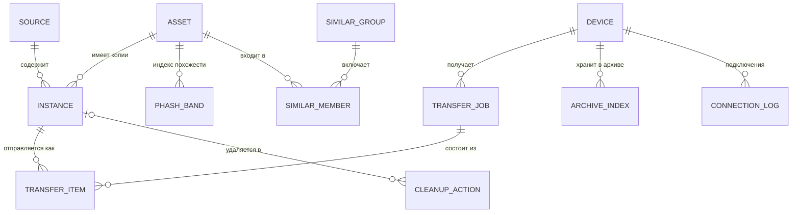

# Модель данных

У каждого устройства — **своя локальная база SQLite** с одной и той же схемой (Room 3, [ADR 0010](adr/0010-room3.md)).
Серверной базы данных в v1.0 нет.

Секреты (токены облаков, приватные ключи устройства) в базе **не хранятся** — только в защищённом
хранилище ОС (Keychain / Android Keystore / системный keyring), см. [безопасность](security-privacy.md).

## Главная идея: «фотография» и «копии»

Одна и та же фотография может лежать в пяти местах. Поэтому разделяем:

- **asset** — логическая фотография (или видео): «снимок заката 12 июля 2025 в 21:14»;
- **instance** — физическая копия в конкретном источнике: «файл `IMG_1234.HEIC` в Яндекс Диске, 3,1 МБ».

Лента показывает **assets**. Карточка «Где лежит» показывает все **instances** одного asset.
Дубли между облаками — это просто asset с несколькими instances.



## Схема (черновик)

```sql
-- Подключённые источники
CREATE TABLE source (
  id              INTEGER PRIMARY KEY,
  kind            TEXT    NOT NULL,  -- DEVICE_GALLERY, YANDEX_DISK, DROPBOX, ONEDRIVE, WEBDAV,
                                     -- GOOGLE_PHOTOS_PICKER, GOOGLE_TAKEOUT, LOCAL_FOLDER, PIXROOST_ARCHIVE
  title           TEXT    NOT NULL,  -- «Яндекс Диск», «Архив на ПК-Дом»
  account_label   TEXT,              -- логин, который видит пользователь
  config_json     TEXT    NOT NULL DEFAULT '{}',
  sync_cursor     TEXT,              -- курсор инкрементальной синхронизации
  quota_total     INTEGER,
  quota_used      INTEGER,
  is_trusted      INTEGER NOT NULL DEFAULT 0,  -- «надёжное хранилище» для правила безопасности
  status          TEXT    NOT NULL,  -- OK, SYNCING, AUTH_REQUIRED, ERROR, DISABLED
  last_sync_at    INTEGER
);

-- Логическая фотография / видео
CREATE TABLE asset (
  id                INTEGER PRIMARY KEY,
  media_type        TEXT    NOT NULL,  -- PHOTO, VIDEO, LIVE_PHOTO
  taken_at          INTEGER,           -- UTC, мс; из EXIF DateTimeOriginal или метаданных источника
  tz_offset_min     INTEGER,
  width             INTEGER,
  height            INTEGER,
  duration_ms       INTEGER,
  phash             INTEGER,           -- 64-битный pHash превью; NULL — ещё не посчитан
  is_blank          INTEGER NOT NULL DEFAULT 0, -- 1 — пустой кадр: хэш хранится, но в поиск не попадает (см. «Как считаем pHash»)
  best_instance_id  INTEGER            -- копия лучшего качества (только для просмотра, не для уборки)
);
CREATE INDEX asset_taken_at ON asset(taken_at DESC);

-- Физическая копия в источнике
CREATE TABLE instance (
  id             INTEGER PRIMARY KEY,
  asset_id       INTEGER NOT NULL REFERENCES asset(id),
  source_id      INTEGER NOT NULL REFERENCES source(id) ON DELETE CASCADE,
  remote_key     TEXT    NOT NULL,     -- id или путь внутри источника
  file_id        TEXT,                 -- сам файл: id в облаке, NTFS file ID, dev:inode; две ссылки на файл — один file_id
  file_name      TEXT,
  mime_type      TEXT,
  size_bytes     INTEGER,
  md5            BLOB,                 -- если известен (от провайдера или посчитан)
  sha256         BLOB,                 -- если известен
  provider_hash  TEXT,                 -- хэш в формате провайдера: Dropbox content_hash, quickXorHash
  quality        TEXT    NOT NULL,     -- ORIGINAL, REDUCED, UNKNOWN
  modified_at    INTEGER,
  revision       TEXT,                 -- ревизия в источнике: rev, eTag, поколение MediaStore; у папок на ПК — размер,
                                       -- время изменения, ChangeTime (Windows) или ctime (Linux) и file_id
  hashed_revision TEXT,                -- ревизия, от которой посчитан sha256; новая ревизия сбрасывает sha256 и verified_at
  in_shared_folder INTEGER,            -- 1 — файл в общей папке или чужой файл по ярлыку; NULL — неизвестно, считается как 1
  state          TEXT    NOT NULL,     -- PRESENT, TRASHED, MISSING
  verified_at    INTEGER,              -- когда содержимое сверено по SHA-256
  last_seen_at   INTEGER NOT NULL,
  UNIQUE (source_id, remote_key)
);
CREATE INDEX instance_asset  ON instance(asset_id);
CREATE INDEX instance_sha256 ON instance(sha256);
CREATE INDEX instance_md5    ON instance(md5);

-- Индекс для поиска похожих: 64-битный pHash, разрезанный на 5 «полос» по 13/13/13/13/12 бит (LSH)
CREATE TABLE phash_band (
  asset_id  INTEGER NOT NULL REFERENCES asset(id) ON DELETE CASCADE,
  band      INTEGER NOT NULL,          -- 0..4
  value     INTEGER NOT NULL,          -- 12 или 13 бит
  PRIMARY KEY (band, value, asset_id)
);

-- Группы похожих кадров
CREATE TABLE similar_group (
  id          INTEGER PRIMARY KEY,
  kind        TEXT    NOT NULL,        -- SAME_SHOT (та же фотография, другое качество), SIMILAR (серия)
  created_at  INTEGER NOT NULL,
  dismissed   INTEGER NOT NULL DEFAULT 0
);
CREATE TABLE similar_member (
  group_id  INTEGER NOT NULL REFERENCES similar_group(id) ON DELETE CASCADE,
  asset_id  INTEGER NOT NULL REFERENCES asset(id) ON DELETE CASCADE,
  distance  INTEGER,
  PRIMARY KEY (group_id, asset_id)
);

-- Сопряжённые устройства
CREATE TABLE device (
  id                  TEXT    PRIMARY KEY,  -- UUID устройства
  name                TEXT    NOT NULL,
  platform            TEXT    NOT NULL,     -- ANDROID, IOS, MACOS, WINDOWS, LINUX
  role                TEXT    NOT NULL,     -- PHONE, DESKTOP
  public_key          BLOB    NOT NULL,     -- P-256, ключ устройства (Secure Enclave / Keystore)
  transport_key       BLOB,                 -- Ed25519, транспортный ключ для удалённого доступа
  cert_sha256         BLOB,                 -- отпечаток TLS-сертификата ПК (пиннинг)
  permissions         TEXT    NOT NULL,     -- UPLOAD, BROWSE, DOWNLOAD, REMOTE, MANAGE (через запятую)
  invited_by          TEXT,                 -- id устройства, которое пригласило (если не через QR на ПК)
  last_address        TEXT,
  last_seen_at        INTEGER,
  is_default_archive  INTEGER NOT NULL DEFAULT 0,
  archive_is_trusted  INTEGER NOT NULL DEFAULT 1,  -- архив этого ПК — надёжное место для правила безопасности
  paired_at           INTEGER NOT NULL,
  revoked_at          INTEGER               -- не NULL → ключ отозван, соединения отклоняются
);

-- Журнал подключений (ведёт ПК)
CREATE TABLE connection_log (
  id          INTEGER PRIMARY KEY,
  device_id   TEXT    NOT NULL,
  at          INTEGER NOT NULL,
  route       TEXT    NOT NULL,        -- LAN, REMOTE
  event       TEXT    NOT NULL,        -- PAIRED, CONNECTED, UPLOAD, DOWNLOAD, REJECTED_REVOKED, PAIRING_FAILED
  details     TEXT
);

-- Очередь передачи
CREATE TABLE transfer_job (
  id          INTEGER PRIMARY KEY,
  device_id   TEXT    NOT NULL REFERENCES device(id),
  kind        TEXT    NOT NULL,        -- MANUAL, AUTO_ARCHIVE
  status      TEXT    NOT NULL,        -- QUEUED, RUNNING, PAUSED, DONE, FAILED
  created_at  INTEGER NOT NULL
);
CREATE TABLE transfer_item (
  id           INTEGER PRIMARY KEY,
  job_id       INTEGER NOT NULL REFERENCES transfer_job(id) ON DELETE CASCADE,
  instance_id  INTEGER NOT NULL REFERENCES instance(id),
  upload_id    TEXT,                   -- id загрузки на стороне ПК (для докачки)
  bytes_total  INTEGER,
  bytes_sent   INTEGER NOT NULL DEFAULT 0,
  status       TEXT    NOT NULL,       -- QUEUED, UPLOADING, VERIFYING, DONE, SKIPPED_EXISTS, FAILED
  error        TEXT,
  saved_path   TEXT,
  finished_at  INTEGER
);

-- Кэш на телефоне: какие файлы уже есть в архиве на каждом ПК (синхронизируется с ПК)
CREATE TABLE archive_index (
  device_id   TEXT NOT NULL REFERENCES device(id) ON DELETE CASCADE,
  sha256      BLOB NOT NULL,
  saved_path  TEXT,
  PRIMARY KEY (device_id, sha256)
);

-- Журнал уборки. Строка самодостаточна: при отключении источника (E2.6) копии удаляются каскадом,
-- ссылки на них обнуляются, а запись остаётся
CREATE TABLE cleanup_action (
  id                  INTEGER PRIMARY KEY,
  plan_id             TEXT    NOT NULL,
  instance_id         INTEGER REFERENCES instance(id) ON DELETE SET NULL,  -- удаляемая копия
  file_name           TEXT,
  size_bytes          INTEGER,
  source_kind         TEXT    NOT NULL,       -- вид источника удаляемой копии
  source_title        TEXT    NOT NULL,       -- название источника, как его видел пользователь
  remote_key          TEXT    NOT NULL,       -- id или путь внутри источника
  trash_key           TEXT,                   -- как найти файл в корзине для «Восстановить», если источник его отдаёт
  deleted_sha256      BLOB    NOT NULL,
  keeper_kind         TEXT    NOT NULL,       -- INSTANCE (копия в источнике) или ARCHIVE (файл в архиве на ПК)
  keeper_instance_id  INTEGER REFERENCES instance(id) ON DELETE SET NULL,  -- хранитель-копия; NULL после отключения
                                              -- её источника
  keeper_device_id    TEXT,                   -- ПК, в архиве которого лежит хранитель (keeper_kind = ARCHIVE)
  keeper_title        TEXT    NOT NULL,       -- где лежит хранитель, как его видел пользователь: «Dropbox», «Архив на ПК-Дом»
  keeper_sha256       BLOB    NOT NULL,
  action              TEXT    NOT NULL,       -- TRASH
  status              TEXT    NOT NULL,       -- PLANNED, DONE, FAILED, REFUSED (отказ при повторной проверке), RESTORED
  denial_reason       TEXT,                   -- причина отказа CleanupSafetyPolicy
  executed_at         INTEGER,
  trash_expires_at    INTEGER,                -- до какого времени копию гарантированно можно вернуть; NULL — срок неизвестен
  restored_at         INTEGER,
  error               TEXT
);
```

Схема — отправная точка; окончательная появится в модуле `:shared:database` и будет меняться только
через миграции.

## Как определяем одинаковые фото

Три уровня «одинаковости». Удалить можно **только точную копию** (первый уровень). По похожести Pixroost
не удаляет никогда: [ADR 0011](adr/0011-cleanup-safety-rule.md).

| Уровень | Как определяем | Пример | Что делаем |
|---|---|---|---|
| **1. Точная копия** | совпадает SHA-256 содержимого (или MD5 от двух провайдеров) | один и тот же `IMG_1234.HEIC` в iCloud, Яндексе и архиве на ПК | один asset, несколько instances; лишние копии можно удалить по правилу безопасности. Совпадение MD5 или хэша провайдера только объединяет копии в группу: для удаления нужен SHA-256, проверенный у обеих копий |
| **2. Тот же кадр, другое качество** | одинаковая дата съёмки (±1 с) + те же пропорции + pHash, расстояние Хэмминга ≤ 4; без даты съёмки в этот уровень не попадает | оригинал в iCloud и сжатая копия в Google Фото | группа `SAME_SHOT` для просмотра: копии показаны нейтрально, ничего не выбрано; удалить можно только точную копию — после «Отправить на ПК» ([ниже](#группа-тот-же-кадр-другое-качество)) |
| **3. Похожие кадры** | pHash, расстояние ≤ 10 и разница во времени ≤ 60 с; без даты — расстояние ≤ 4 (эта ветка спайком не измерена) | серия из 8 снимков одного заката | группа `SIMILAR`; ничего не выбрано по умолчанию |

### Как считаем pHash

Правила проверены спайком S-06 ([#26](https://github.com/intelbetteramd-sys/pixroost/issues/26)):
4 прогона на 350 реальных фото на Windows.

- **Хэш.** 64-битный pHash по схеме `imagehash`: DCT серого изображения 32×32, берутся 8×8 низких частот,
  порог — медиана. Уменьшение до 32×32 — усреднением по площади (среднее по покрытой области). Ступенчатое
  уменьшение вдвое с билинейным шагом на копиях другого размера «плыло»: на расстоянии ≤ 4 находилось
  90,6 / 93,7 / 92,0 % копий 1280 / 1600 / 512 px. С усреднением по площади для каждого вида копий
  (вдвое меньше, JPEG 60, JPEG 30, 1280, 1600, 512 px) находится 99,7–100 %, медианное расстояние 0.
  dHash на копиях другого размера хуже (24 % на расстоянии ≤ 4 для 1280 px) и не используется.
- **Поворот.** Поворот по EXIF применяется до хэша, пропорций и любых других проверок: мессенджеры и облака
  запекают поворот в пиксели. В тестовой папке повёрнутых фото не было, поэтому это правило, а не измеренное число.
- **Пустые кадры.** Если стандартное отклонение серого изображения 32×32 (шкала 0–1) меньше 0,01, кадр
  исключается из поиска: у чёрных снимков из кармана хэш случайный. Хэш при этом хранится как обычно, а
  кадр помечается `is_blank`; строк `phash_band` у него нет. В наборе таких было 11 из 350, все ниже 0,01;
  самое тёмное настоящее фото — 0,031. Порог 0,01 оставляет самый широкий запас для тёмных настоящих фото;
  спайк работал с порогом 0,02, на этом наборе разницы нет.
- **Индекс.** 5 полос по 13/13/13/13/12 бит находят все пары на расстоянии ≤ 4 (принцип Дирихле: при 4
  отличающихся битах хотя бы одна полоса совпадает полностью). 4 полосы по 16 бит теряют пары ровно на
  расстоянии 4 (в первом прогоне 0,9–1,6 %). Цена: 0,20 % случайных пар разных фото становятся кандидатами
  (при 4 полосах — 0,04 %); на 50 000 фото это около 2,5 млн сравнений 64-битных чисел, пренебрежимо мало.
  Кандидатов затем проверяют по точному расстоянию Хэмминга.
- **Время съёмки.** `DateTimeOriginal` со смещением `OffsetTimeOriginal`, если оно есть. Без смещения —
  самое частое смещение среди фото того же источника, а если его нет, местное время как есть (так делал
  спайк). Пропорции сравниваются с допуском 1 % плюс один пиксель на округление (панорамы в превью 512 px).
- **Копии в спайке.** Копия наследовала время съёмки оригинала. В продукте копия из мессенджера без EXIF
  даты не имеет и попадает только в «Похожие кадры».

#### Результаты

| Проверка | Итог |
|---|---|
| «Тот же кадр» (pHash ≤ 4, время ±1 с, те же пропорции) | 0 ложных пар из 54 946 пар разных фото с датой; точность 100 % при цели ≥ 95 % (с учётом перекрёстных пар копий — тоже 100 %) |
| Только pHash, без учёта даты (все пары разных фото в наборе) | точность 92,37 % с учётом копий; все близкие пары разных фото — настоящие похожие кадры, проверено глазами: четыре почти одинаковых скриншота одного экрана с интервалом в секунды (расстояние 0), повторный снимок той же сцены (4), серия с человеком в чуть другой позе через 7 с (6) |
| «Похожие кадры» (≤ 10 и ≤ 60 с) | 3 пары, все настоящие серии; порог оставлен. Ветка «без даты, расстояние ≤ 4» спайком не измерялась: пары без даты в этот подсчёт не входили |

pHash не путает несвязанные фото, но не отличает копию от повторного снимка. Поэтому пара без даты съёмки
никогда не становится «Тот же кадр»: она попадает в «Похожие кадры».

Скорость на ПК не показательна: там хэш считался по полным фото, а приложение хэширует превью. Проверка
на телефоне — остаток спайка: хэш превью против хэша оригинала, скорость, копии HEIC → JPEG (в спайке
их не было) и учёт ориентации EXIF в системных превью.

### Откуда берутся хэши

| Источник | Что есть сразу | Что считаем сами |
|---|---|---|
| Яндекс Диск | MD5, SHA-256 | — |
| Dropbox | `content_hash` | SHA-256 — только если нужно сравнить с другим источником |
| OneDrive | quickXorHash (и, возможно, SHA-1) | SHA-256 по требованию |
| Галерея, папки, Takeout | — | SHA-256 при индексации (локально это быстро) |
| Архив на ПК | SHA-256 — считается при приёме | — |

Для облака без подходящего хэша полный SHA-256 считается **только когда он нужен**: перед удалением,
при уборке. Это экономит трафик.

Хэш верен только для той версии файла, от которой его посчитали. Вместе с `sha256` запоминается ревизия
(`hashed_revision`). Если синхронизация видит у копии новую ревизию, она сбрасывает `sha256`, `md5` и
`verified_at`, и хэш считается заново, когда понадобится. Хэш, который отдаёт провайдер (SHA-256 у Яндекс Диска),
приходит в том же ответе, что и ревизия, и записывается вместе с ней.

Хэш, который считаем скачиванием (Dropbox, OneDrive, WebDAV), считается по закреплённой ревизии: у Dropbox файл
скачивается по `rev:`, у OneDrive и WebDAV — с `If-Match` по eTag. `hashed_revision` берётся из ответа на это
скачивание, а не из базы: иначе файл, изменённый во время скачивания, получил бы хэш, подписанный не той
ревизией. У локальных файлов ревизия читается до и после подсчёта; если она изменилась, хэш отбрасывается.

У папок на ПК размер и время изменения не доказывают, что файл тот же: программы, которые ставят дату файла
по EXIF, возвращают прежнее время изменения, а правка EXIF на месте часто не меняет размер. Поэтому в ревизию
входит и время, которое обычные программы не выставляют: `ChangeTime` из `FILE_BASIC_INFO` на Windows, `ctime`
на Linux, — и `file_id`.

### Группа «Тот же кадр, другое качество»

S-06 показал, что группа `SAME_SHOT` надёжно собирает один и тот же кадр. Но у худшей по виду копии может быть
то, чего нет у лучшей: геолокация, правки, видео Motion Photo / Live Photo, исходный формат. Поэтому группа —
для просмотра, а не для выбора, что удалить ([ADR 0011](adr/0011-cleanup-safety-rule.md)):

- ничего не выбрано, чекбоксов и «выбрать все худшие» нет;
- у каждой копии: источник, разрешение, формат, размер и то, что есть только у неё;
- метка «лучшее качество» — только если копия строго больше по обеим сторонам (после поворота по EXIF),
  а у остальных копий нет ничего своего;
- действия: «Отправить на ПК» для любой копии; для копии, которая уже в архиве, — «Удалить из <источник>»
  (обычное удаление по правилу ниже, хранитель — тот же файл в архиве); «Это разные кадры»
  (`similar_group.dismissed`);
- группа, все копии которой в архиве, закрыта; без сопряжённого ПК — только «Это разные кадры».

### Правило безопасности удаления

Удаляется только точная копия. План уборки — список пар «кандидат — хранитель»
(`PlannedDeletion(candidate, keeper)`), и проверяется план **целиком**. Хранитель — либо копия в источнике
(строка `instance`), либо файл в архиве на ПК: на телефоне архив хранится не как `instance`, а как запись
`archive_index`.

```
удалить кандидата C по паре (C, K) из плана P можно, если:
  K — не C и не кандидат ни в одной паре плана P
  SHA-256 кандидата посчитан для его текущей ревизии: verified_at не пустой, C.hashed_revision = C.revision
  K есть прямо сейчас, и его SHA-256 равен SHA-256 кандидата:
    K — копия в источнике: K.state = PRESENT, SHA-256 посчитан для текущей ревизии K
    K — файл в архиве на ПК: ПК только что проверил файл на диске (запрос verify)
  источник K надёжный, и его вид не GOOGLE_PHOTOS_PICKER и не GOOGLE_TAKEOUT
  ни C, ни K не лежат в общей папке, и коннектор знает это наверняка
  K в другом домене хранения, чем C, или K и C — разные файлы (разный file_id) одного источника
  у C есть восстанавливаемая корзина: источник объявил Capability.TRASH для этой версии ОС и этого тома
  ревизия C известна и равна ревизии из плана
```

Совпадение MD5, `content_hash` Dropbox или quickXorHash OneDrive удаления не разрешает: оно только объединяет
копии в группу точных дублей. Нужен SHA-256 обеих копий, посчитанный для их текущих ревизий.

Если копия есть в архиве на ПК, хранителем выбирается архив: уборка не удаляет файлы архива как источника ни на
одном устройстве. Если же архив лежит в домене облака, его файлы удаляются через это облако, поэтому для
блокировки уборки такой хранитель считается облачным ([выполнение плана](#выполнение-плана)).

#### Домен хранения

Домен хранения — место, где удаление одного файла удаляет и другой. Хранитель должен лежать в другом домене,
иначе «опорная копия» может оказаться тем же файлом.

| Домен | Что в него входит |
|---|---|
| облачный аккаунт | сам аккаунт (Яндекс Диск, Dropbox, OneDrive, сервер WebDAV с логином) и папка синхронизации клиента этого облака на ПК. Аккаунт клиента синхронизации Pixroost не видит, поэтому папка синхронизации любого облака — один домен со всеми подключёнными аккаунтами этого облака |
| общая папка | файл в общей папке виден в нескольких аккаунтах и удаляется у всех. В v1.0 такие копии не бывают хранителями и не удаляются ([ниже](#общие-папки)) |
| архив Pixroost | папка архива на ПК. Если она лежит внутри папки синхронизации, она в домене этого облака ([домен архива](#домен-архива)) |
| папки на ПК | каждая папка-источник — свой домен. Папки, вложенные друг в друга, и архив внутри папки-источника — один домен |
| галерея телефона | телефон. ⚠️ проверить: Samsung Gallery синхронизируется с OneDrive (папка «Изображения/Samsung Gallery»), и удаление, похоже, переходит в обе стороны. До проверки копии OneDrive из этой папки — один домен с галереей телефона. На этапе iOS галерея с включёнными iCloud Фото — один домен с iCloud и его папкой на ПК |

Домены известных клиентов синхронизации (iCloud для Windows, Google Drive, Яндекс Диск, Облако Mail.ru, OneDrive,
Dropbox) определяются по их папкам.

##### Домен архива

Папка архива может оказаться внутри папки синхронизации уже после того, как её выбрали: Known Folder Move в
OneDrive переносит «Изображения» и «Документы» в OneDrive, пользователь переносит папку сам. Путь может вести
в папку синхронизации через junction или symlink, а клиент синхронизации может хранить свою папку не там, где
по умолчанию. Поэтому домен архива не запоминается один раз:

- ПК вычисляет домен заново при каждом ответе на запрос `verify`, и не для корня архива, а для **каждого файла**:
  подпапка архива, например `2024`, может быть junction или symlink в папку OneDrive или на другой том. Домен
  определяется по каноническому пути самого файла (`GetFinalPathNameByHandle` от его handle на Windows,
  `realpath` на Linux). Корни папок синхронизации берутся из настроек
  клиентов: у OneDrive — из реестра (`Accounts\*\UserFolder`), у Dropbox — из `info.json`. Где путь хранят
  остальные клиенты — ⚠️ проверить;
- в корне архива лежит скрытый файл-метка `.pixroost-archive-<id ПК>`. Если индексация облака находит такую метку,
  архив этого ПК — в домене этого облака, даже если его клиент синхронизации Pixroost не знает. Находка
  запоминается у источника и учитывается при каждой проверке;
- при выборе папки архива внутри известной папки синхронизации ПК предупреждает: «Архив внутри папки OneDrive:
  удаление из OneDrive удалит и копию в архиве».

##### Один и тот же файл

Исключение «другой файл того же источника» сверяется по самому файлу, а не по пути. В папке на ПК `a\IMG.jpg` и
`b\IMG.jpg` — один файл, если `b` — symlink или junction на `a` или это жёсткая ссылка. Поэтому:

- индексатор папок не заходит по символическим ссылкам и junction;
- одинаковость файла определяется по `file_id`: NTFS file ID на Windows, пара `dev` + `inode` на Linux;
- в облаке исключение работает, только если API даёт копиям разные id и ни одна из них не ярлык чужого файла
  (`remoteItem` в OneDrive).

##### Этап iOS

Удаление `PHAsset` убирает все его ресурсы: фото, видео Live Photo и правки. Поэтому для кандидата из галереи
iPhone хранитель нужен для SHA-256 **каждого** ресурса, а не только основного HEIC. Иначе в архиве останется
фото без видео.

#### Общие папки

В общих папках Яндекс Диска и Dropbox, в общих файлах и ярлыках OneDrive («Добавить в Мои файлы») один файл виден
в нескольких аккаунтах. Семейный сценарий: подключены аккаунты двух человек, у них общая папка «Семья». Копия
в аккаунте A и копия в аккаунте B — один файл, и удаление одной уберёт обе, причём у обоих людей.

В v1.0:

- копия в общей папке не бывает хранителем (`KEEPER_IN_SHARED_FOLDER`);
- удалять из общей папки Pixroost не предлагает (`CANDIDATE_IN_SHARED_FOLDER`): файл пропал бы и у остальных
  участников папки;
- признак `instance.in_shared_folder` ставит коннектор: у Dropbox — по `sharing_info` и `parent_shared_folder_id`,
  у OneDrive — по `remoteItem` и общему доступу к папке-предку, у Яндекс Диска — ⚠️ проверить, как API отмечает
  общие папки. Если коннектор не может это узнать, папка считается общей;
- у папок на ПК (`LOCAL_FOLDER`) признак ставит индексатор. Папка вне известных папок синхронизации — `0`.
  Внутри папки синхронизации признак берётся у копии того же облака по тому же пути, если это облако подключено
  к Pixroost; иначе `NULL`, то есть копия считается общей. Иначе ПК удалил бы локальную копию из общей папки
  «Семья», а клиент синхронизации удалил бы файл в облаке у всех участников.

Свой домен хранения на каждую общую папку у провайдера (одна папка — один домен во всех аккаунтах) — возможное
развитие после v1.0.

#### Корзина

Удаляем только в корзину, из которой файл можно вернуть. Источник объявляет `Capability.TRASH` честно:
для конкретной версии ОС и конкретного тома. Но и из корзины файл не всегда можно вернуть в срок, который обещает
сервис: корзины переполняются, а галереи многих производителей не показывают системную корзину Android. Поэтому
в журнал записывается гарантированный срок, а вернуть файл можно кнопкой «Восстановить» в журнале Pixroost.

| Источник | Корзина | Удаление в v1.0 | Срок в `trash_expires_at` | «Восстановить» |
|---|---|---|---|---|
| галерея Android 11+ (API 30+) | корзина `MediaStore.createTrashRequest`, системный диалог | да | `DATE_EXPIRES` из MediaStore | `createTrashRequest(uris, false)`, системный диалог. Во многих галереях производителей корзина MediaStore не видна, поэтому вернуть файл предлагает сам Pixroost |
| галерея Android 8–10 (API 26–29) | нет | **нет**, интерфейс объясняет почему | — | — |
| Яндекс Диск | корзина Диска | да | срок хранения корзины ⚠️ проверить | API восстановления из корзины |
| Dropbox | удалённые файлы | да | срок для тарифа пользователя ⚠️ проверить | `files/restore` |
| OneDrive (личный) | корзина | да | 3 дня: когда корзина занимает больше 10 % квоты, OneDrive удаляет старые файлы через 3 дня, а не через 30 | `restore` в Microsoft Graph ⚠️ проверить |
| WebDAV | в протоколе нет | нет, только чтение | — | — |
| Google Photos Picker, Google Takeout | удаления нет | нет; хранителями эти копии не бывают | — | — |
| папки на Windows | корзина Windows | только на томах, где корзина включена и файл в неё помещается (ниже). ⚠️ проверить: съёмные и сетевые диски | `NULL`: переполненная корзина сама выбрасывает старые файлы | ⚠️ проверить; иначе подсказка, где искать файл в корзине |
| папки на Linux | корзина freedesktop.org | только на томах, где есть корзина. ⚠️ проверить: съёмные и сетевые диски | `NULL` | ⚠️ проверить; иначе подсказка |
| архив Pixroost | — | уборка архив не трогает | — | — |

Корзина Windows удаляет файл навсегда, если он больше предела корзины на томе или корзина на томе отключена.
Если программа подавляет вопросы, это происходит молча. Поэтому ПК:

- перед удалением читает настройки корзины тома и не удаляет файлы, которые в неё не поместятся;
- удаляет через `IFileOperation` в корзину и просит Windows предупреждать об удалении навсегда; такое
  предупреждение считается ошибкой, удаление навсегда не подтверждается. ⚠️ проверить в прототипе, что
  удаление навсегда так ловится всегда.

#### Выполнение плана

План строится по локальной базе, а индекс архива на телефоне (`archive_index`) — только кэш. Между проверкой
и удалением может пройти много времени: системный диалог корзины галереи пользователь может держать открытым
сколько угодно, а большая партия в облаке идёт минутами. За это время хранителя могут удалить в самом сервисе.
Поэтому план выполняется так:

1. **Один план за раз.** На устройстве выполняется только один план. Новый план строится после сверки строк
   `PLANNED` ([ниже](#сверка-после-сбоя)), и кандидаты и хранители незавершённого плана в него не попадают.
2. **Не одновременно с ПК.** Телефон и ПК не убирают одни и те же облака одновременно. Иначе телефон удалил бы
   копию из Яндекс Диска с хранителем в Dropbox, а ПК в это же время — из Dropbox с хранителем в Яндекс Диске:
   каждая проверка видит чужого хранителя на месте, и в корзину уходят обе копии. Пары, у которых хранитель
   в домене облачного аккаунта, телефон выполняет только под блокировкой `POST /v1/cleanup/lock` от каждого
   сопряжённого ПК ([блокировка](devices-and-transfer.md#блокировка-уборки)). Пока блокировка действует, ПК
   свою уборку не начинает, а если уборка на ПК уже идёт, отказывает. Для своей уборки ПК берёт ту же блокировку
   у себя. Если ПК не в сети, такие пары ждут его. Хранитель в архиве, который `verify` отнёс к домену облака,
   считается облачным: если архив лежит в папке синхронизации OneDrive, ПК может удалить его файл как копию
   OneDrive. Хранитель в архиве вне доменов облаков блокировки не требует: такие файлы не удаляет ни одна уборка.
   Блокировка — аренда на срок: телефон отсчитывает его по своим монотонным часам с момента отправки запроса,
   с запасом, и продлевает заранее. Если продлить не удалось (например, телефон ушёл из домашней Wi-Fi и
   продолжает удалять через мобильную сеть), телефон сразу прекращает пары с хранителем в облаке и возобновляет
   их только с новой блокировкой. ПК отсчитывает срок от получения запроса, то есть позже телефона, поэтому
   к моменту, когда блокировка истечёт на ПК, телефон уже не удаляет.
3. **Проверка перед каждой партией `trash()`.** Партии маленькие. Перед каждой:
   1. инкрементальная синхронизация источников из партии;
   2. запрос `POST /v1/archive/verify` к ПК о хранителях в архиве: ПК проверяет файлы на диске прямо сейчас
      ([как](devices-and-transfer.md#проверка-архива-перед-удалением)). Ни индекс на телефоне, ни база ПК для
      этого не годятся. Если ПК не ответил или не смог проверить файл, хранитель не найден
      (`KEEPER_NOT_PRESENT`);
   3. `CleanupSafetyPolicy` оценивает партию заново по свежим фактам;
   4. если ревизия кандидата (`rev` у Dropbox, eTag у OneDrive, ревизия Яндекс Диска, поколение `MediaStore`,
      размер и время изменения файла) изменилась после построения плана — отказ `CANDIDATE_CHANGED`: пользователь
      подтверждал удаление другой версии файла. Если ревизию сравнить нельзя — тоже отказ.

   Для галереи проверка идёт прямо перед открытием системного диалога. Если с последней проверки прошло больше
   предела из `CleanupConstants`, партия проверяется заново.
4. **Проверка после партии.** Источники хранителей синхронизируются ещё раз, хранители в архиве снова
   проверяются запросом `verify`. Хранитель исчез, если его нет, если `verify` ответил «не удалось проверить»
   или ПК не ответил: проверить, что опора на месте, нельзя, а возврат из корзины ничего не теряет. Тогда план
   останавливается, а кандидаты этой партии сразу возвращаются из корзины там, где источник это умеет (строка
   журнала — `RESTORED`). Партии маленькие, поэтому обрыв Wi-Fi возвращает одну партию, а не всю уборку. Для
   галереи приложение сразу открывает системный диалог возврата. Где вернуть нельзя, приложение сразу
   предупреждает, как [наблюдатель](#наблюдатель).

   Возврат не перезаписывает новый файл, который за это время появился по тому же пути: у Яндекс Диска возврат
   идёт с `overwrite=false`, у OneDrive при занятом пути — под другим именем (⚠️ проверить), а `files/restore`
   у Dropbox пишет ревизию поверх пути, поэтому для Dropbox путь проверяется прямо перед возвратом, и если он
   занят, возврата нет, только предупреждение. Так же работает «Восстановить» в журнале.

Отказы попадают в журнал со статусом `REFUSED` и причиной и показываются в итоге уборки. Два телефона с одними
и теми же облаками и без общего ПК друг о друге не знают; этот случай закрывает только проверка после партии.

##### Сверка после сбоя

Если приложение упало между `trash()` и записью `DONE`, строка журнала остаётся `PLANNED`, и наблюдатель её
не видит. Поэтому при запуске, до построения нового плана, такие строки сверяются с источником:

- кандидат в корзине → `DONE`, срок корзины берётся из источника;
- кандидат на месте → `FAILED` с пометкой «уборка прервана»;
- кандидата нет ни на месте, ни в корзине → `FAILED`, и итог уборки об этом говорит.

#### `CleanupSafetyPolicy`

Правило реализовано в одном месте — чистой функции в `commonMain`, без ввода-вывода. Она видит только копии
и их факты; групп, pHash и дат съёмки во входных данных нет, поэтому удаление по похожести через неё не выразить.
Набросок API:

```kotlin
sealed interface Keeper {
    data class Instance(val instanceId: Long) : Keeper // копия в источнике
    data class Archive(val deviceId: String, val sha256: Sha256) : Keeper // файл в архиве на ПК
}

data class PlannedDeletion(val candidateId: Long, val keeper: Keeper, val candidateRevision: String?)

fun evaluate(
    plan: List<PlannedDeletion>,
    copies: Map<Long, CopySnapshot>, // instance id → состояние, SHA-256 и его ревизия, ревизия, источник,
                                     // домен хранения, file_id, общая папка, корзина
    archives: Map<ArchiveFileKey, ArchiveSnapshot>, // (ПК, SHA-256) → ответ verify, домен архива, надёжность
): Map<PlannedDeletion, CleanupVerdict> // Allowed или Denied(reasons: Set<DenialReason>)
```

Надёжность архива на телефоне хранится в `device.archive_is_trusted`. На ПК его собственный архив — тоже
`Keeper.Archive` с id этого ПК, а факты о нём даёт та же проверка файла на диске, что отвечает на `verify`.

| `DenialReason` | Когда |
|---|---|
| `UNKNOWN_COPY` | нет фактов о кандидате или о хранителе-копии |
| `CANDIDATE_HASH_NOT_VERIFIED` | SHA-256 кандидата не посчитан или посчитан не для текущей ревизии; совпал только MD5 или хэш провайдера |
| `KEEPER_HASH_NOT_VERIFIED` | то же для хранителя-копии |
| `HASH_MISMATCH` | SHA-256 хранителя и кандидата различаются |
| `KEEPER_NOT_PRESENT` | хранитель-копия не `PRESENT`; для архива — ПК не ответил на `verify`, не смог проверить файл или файла нет |
| `KEEPER_NOT_TRUSTED` | источник хранителя или архив ПК не отмечен надёжным |
| `KEEPER_SOURCE_NOT_ALLOWED` | хранитель — копия Google Photos Picker или Takeout |
| `KEEPER_ALSO_DELETED` | хранитель — сам кандидат этой пары или кандидат другой пары плана |
| `KEEPER_SAME_STORAGE` | хранитель в том же домене хранения и это не другой файл (другой `file_id`) того же источника |
| `KEEPER_IN_SHARED_FOLDER` | хранитель в общей папке или коннектор не знает, общая ли она |
| `CANDIDATE_IN_SHARED_FOLDER` | кандидат в общей папке или коннектор не знает, общая ли она |
| `NO_RECOVERABLE_TRASH` | у источника кандидата нет корзины для этой версии ОС или тома |
| `CANDIDATE_CHANGED` | ревизия кандидата изменилась после плана или её нельзя сравнить, в том числе если она `null` |

Тесты, которые закрепляют правило. Для каждой причины отказа есть тест, где она единственная:

- `UNKNOWN_COPY`: нет фактов о кандидате; нет фактов о хранителе;
- `CANDIDATE_HASH_NOT_VERIFIED` и `KEEPER_HASH_NOT_VERIFIED`: `verified_at` пустой; файл изменили после подсчёта
  хэша, но до построения плана (`hashed_revision` не равна `revision`); файл изменился во время скачивания
  для подсчёта хэша; у папки на ПК размер и время изменения прежние, а `ChangeTime` / `ctime` другой; у копий
  совпал только MD5 или
  `content_hash`;
- `HASH_MISMATCH`;
- `KEEPER_NOT_PRESENT`: хранитель `TRASHED`; хранитель `MISSING`; ПК не ответил на `verify`; индекс ПК говорит
  «есть», а файла на диске нет, том с архивом отключён или файл изменился и его SHA-256 другой; размер и время
  изменения файла архива прежние (дату вернули по EXIF), а `ChangeTime` / `ctime` другой и SHA-256 другой;
- `KEEPER_NOT_TRUSTED`: источник не отмечен надёжным; архив ПК не отмечен надёжным;
- `KEEPER_SOURCE_NOT_ALLOWED`: хранитель из Google Photos Picker или Takeout, даже если источник отмечен надёжным;
- `KEEPER_ALSO_DELETED`: две копии одного файла в одном плане служат хранителями друг другу — обе отклонены;
  кандидат — свой собственный хранитель `(C, C)`;
- `KEEPER_SAME_STORAGE`: папка синхронизации любого облака и само облако; архив внутри папки синхронизации;
  Known Folder Move перенёс архив в OneDrive; путь архива ведёт в папку синхронизации через junction; junction
  внутри архива (подпапка `2024`) ведёт в папку OneDrive, хотя корень архива вне её; в облаке
  найдена метка архива; Samsung Gallery и папка OneDrive «Samsung Gallery»; symlink, junction или жёсткая ссылка
  в одной папке на ПК (тот же `file_id`);
- `KEEPER_IN_SHARED_FOLDER` и `CANDIDATE_IN_SHARED_FOLDER`: копия в общей папке; признак общей папки неизвестен;
  копия в общей папке внутри папки синхронизации на ПК; копия в папке синхронизации, облако которой
  не подключено;
- `NO_RECOVERABLE_TRASH`: галерея на Android API 26–29, WebDAV, том с отключённой корзиной, съёмный диск
  без проверенной корзины;
- `CANDIDATE_CHANGED`: ревизия изменилась; ревизия `null` в плане или в фактах;
- одобрение по исключению: два разных файла (разный `file_id`) одного источника;
- копия из группы `SAME_SHOT` без своего побайтового двойника никогда не одобряется;
- результат не зависит от порядка пар в плане.

Тесты выполнения плана и журнала:

- хранитель исчез между планом и удалением — отказ при повторной проверке;
- хранитель исчез во время партии — план остановлен, кандидат возвращён из корзины; источник без возврата —
  предупреждение;
- второй план на устройстве не начинается, пока первый не закончен;
- телефон не получает блокировку, пока на ПК идёт уборка тех же облаков, и ПК не начинает уборку под чужой
  блокировкой;
- продлить блокировку не удалось — удаления с хранителем в облаке остановлены до новой блокировки;
- хранитель в архиве, который лежит в папке синхронизации, требует блокировки, как хранитель в облаке;
- после партии `verify` ответил «не удалось проверить» или ПК не ответил — план остановлен, партия возвращена
  из корзины;
- возврат из корзины не перезаписывает новый файл по тому же пути;
- строки `PLANNED` после сбоя сверяются при запуске: кандидат в корзине, на месте, нет нигде;
- отключение источника сохраняет журнал.

Тесты наблюдателя:

- хранитель стал `MISSING` или `TRASHED`, другой проверенной копии нет — предупреждение; другая копия есть —
  предупреждения нет;
- срок корзины прошёл — предупреждения нет;
- `trash_expires_at` равен `NULL` — предупреждение без даты;
- `keeper_instance_id` стал `NULL` после отключения источника — «больше не следит»;
- хранитель в архиве: ПК на `verify` ответил, что файла нет, — предупреждение.

Свойство на случайных наборах с фиксированными seed. Для каждой пары `(C, K)`, которую `evaluate` одобрил:

- `K` не кандидат ни в одной паре плана;
- `K` есть: копия `PRESENT` или файл в архиве, подтверждённый `verify`;
- SHA-256 `C` и `K` проверены для их текущих ревизий и равны;
- источник `K` надёжный, и его вид не `GOOGLE_PHOTOS_PICKER` и не `GOOGLE_TAKEOUT`;
- ни `C`, ни `K` не в общей папке;
- `domain(K) ≠ domain(C)` или (`source(K) = source(C)` и `fileId(K) ≠ fileId(C)`);
- у `C` есть корзина;
- `rev(C)` известна и равна ревизии из плана.

Генератор специально строит трудные случаи: взаимных хранителей, общие домены, общие папки, хранителей из Picker
в надёжном источнике, хэши старых ревизий.

#### Наблюдатель

После удаления хранитель может исчезнуть: его удалили в самом сервисе или на ПК. Наблюдатель входит в v1.0 и
работает по журналу после каждой синхронизации и при каждом подключении к ПК. Он смотрит строки `DONE`, пока
удалённая копия может лежать в корзине:

| Что с хранителем | Что делает приложение |
|---|---|
| копия стала `MISSING` или `TRASHED`, и другой проверенной копии нет | предупреждает: «Копия, на которую опиралось удаление, исчезла — восстановите <файл> из корзины <источник> до <дата>», с кнопкой «Восстановить» |
| файл в архиве: ПК на `verify` ответил, что файла нет, и другой проверенной копии нет | то же. Синхронизация телефона архив не видит, поэтому наблюдатель спрашивает ПК при каждом подключении к нему |
| `keeper_instance_id` стал `NULL`: источник хранителя отключили | один раз предупреждает: «Pixroost больше не следит за копией, на которую опиралось удаление <файла>: источник <название> отключён» |

«Другая проверенная копия» — копия, которая сама прошла бы проверку хранителем для этого кандидата: тот же
SHA-256 для её текущей ревизии, `PRESENT`, надёжный источник не из Picker и не из Takeout, не в общей папке,
другой домен хранения.

«Может лежать в корзине» — `trash_expires_at` ещё не прошёл. Если срок неизвестен (`NULL`), считаем, что файл,
возможно, ещё в корзине: предупреждение идёт без даты («…из корзины <источник>, если он ещё там»), а следит
наблюдатель не дольше 30 дней после удаления.

Журнал в v1.0 есть только в базе устройства и теряется при переустановке приложения. После переустановки
наблюдатель за прошлыми удалениями не следит. Это закроет v1.2: ПК будет хранить копию журнала
([#50](https://github.com/intelbetteramd-sys/pixroost/issues/50)).

## После переустановки

Локальная база — это в основном индекс: его можно собрать заново из самих источников.

| Данные | После переустановки |
|---|---|
| Список фото, копии, хэши, группы точных дублей | пересобираются индексацией: ~100–150 запросов к облакам на 20 000 фото |
| Отметки «уже на ПК» | пересобираются сверкой с SHA-256 архива на ПК |
| pHash облачных фото | пересчитываются по превью: ~20 000 запросов на источник, фоном по Wi-Fi |
| Решения пользователя, журнал уборки, настройки | теряются в v1.0; наблюдатель за прошлыми удалениями больше не следит |
| Вход в облака, связка с ПК | проходятся заново намеренно: токены и ключи устройства из Keystore / Keychain не извлекаются |

В v1.0 после переустановки приложение индексирует источники заново. Позже, в v1.2, ПК будет хранить
зашифрованную копию невосстановимых данных телефона и готовые pHash и вернёт их после повторного
сопряжения по QR ([#50](https://github.com/intelbetteramd-sys/pixroost/issues/50)). Своего сервера для этого нет ([ADR 0002](adr/0002-local-first-no-backend.md)).

## Миграции

- Миграции Room: схема каждой версии экспортируется в `shared/database/schemas/` и хранится в репозитории,
  каждая миграция покрыта тестом, CI проверяет их на JVM.
- Никаких «удалим базу и пересоздадим» после релиза: индексация большой медиатеки занимает время,
  а журнал уборки нельзя терять.
